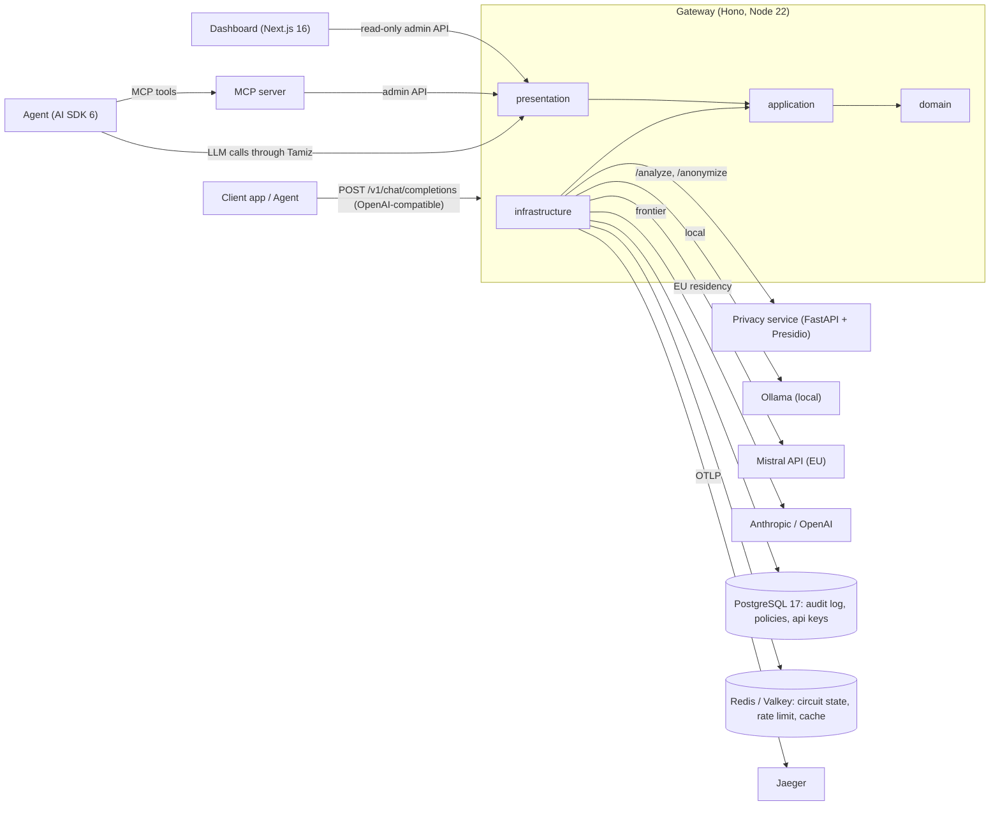
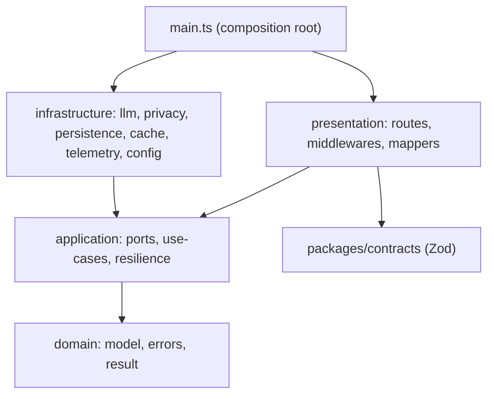
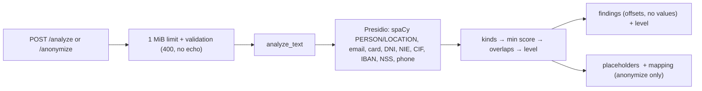

# Tamiz — Architecture

Diagrams for the system view, the request flow and the gateway layers. The narrative and
rationale live in `docs/tamiz-project.md` section 4 and in `docs/adr/`. C4 context and
container diagrams are completed in task `T-DOC-02`.

## System view



## Request flow

```mermaid
sequenceDiagram
    autonumber
    participant C as Client
    participant P as presentation
    participant U as RouteInference (application)
    participant S as Privacy service
    participant D as RoutingPolicy (domain)
    participant R as Resilience (timeout, retry, breaker)
    participant L as LLM provider
    participant A as AuditLog + OTel

    C->>P: POST /v1/chat/completions
    P->>P: Zod validation (packages/contracts)
    P->>U: InferenceRequest
    par in parallel
        U->>U: load the active policy
    and
        U->>S: InspectSensitivity: POST /analyze (cached by SHA-256, positions only)
        S-->>U: entities (kinds, offsets) + sensitivity level, or a failure (fail closed)
    end
    U->>U: ClassifyTask (type, size) + inspection
    U->>D: decide(policy, request)
    D-->>U: route (chain filtered by the level's residencies) or block
    alt block (or detector failed with onDetectorError: block)
        U-->>P: Result.err(Blocked) → 451 / 503, no provider called
    else anonymize
        U->>U: <KIND_n> placeholders + versioned notice; mapping in a closure
    end
    U->>R: execute(chain)
    R->>L: call target 1
    L-->>R: error / timeout
    R->>R: next target (blocked if residency violated)
    R->>L: call target 2
    L-->>R: response
    R-->>U: response (+ fallback event)
    U->>U: restore placeholders (one pass; streams through a placeholder-safe buffer)
    U->>A: AuditEntry (no content) + span (GenAI attrs) + events
    U-->>P: Result.ok(response)
    P-->>C: 200 + x-tamiz-route / x-tamiz-fallback / x-tamiz-sensitivity / x-tamiz-privacy
```

What exists after feature 003: validation, classification, `decide` with the allowed
residencies, and the resilient execution (`application/resilience/execute-chain.ts`:
residency guard → circuit breaker → retry → timeout → next target), for both completions
and streams, with `x-tamiz-route` / `x-tamiz-rule` / `x-tamiz-fallback`. Every step is a
`RoutingEvent` on the routing-events port, logged by default. Circuit state lives in
memory or, with `REDIS_URL`, in Valkey. The privacy service exists since feature 004 (below).
Since feature 005 the gateway calls it on every request (`application/use-cases/
inspect-sensitivity.ts`), applies the policy's privacy action in `decide`, anonymizes
and restores in `protect-messages.ts` / `restore-stream.ts`, and answers
`POST /v1/simulate` with the same steps minus the provider call.

Since feature 006 the use cases are wrapped, outermost first, by:

- **`withAudit` / `withAuditStream`** (`application/audit/with-audit.ts`). They write one
  content-free `AuditEntry` when the request ends (for a stream: the last part, an error
  part, or the client leaving). The entry goes to the bounded in-memory log or, with
  `DATABASE_URL`, to PostgreSQL through an asynchronous batched writer whose losses are
  `audit.dropped` events.
- **`withTracing` / `withTracingStream`** (`application/tracing/with-tracing.ts`). They
  open the `tamiz.request` span. `executeChain` runs each attempt in a `chat {model}`
  child span, and the routing events reach both the log and the active span (`fanOut`).

The admin API reads the same store:

- `GET /v1/admin/audit` (keyset pages);
- `GET /v1/admin/cost` (actual vs baseline);
- `GET /v1/admin/providers` (circuit state plus a window of the log).

| Concern | Port | Adapters |
|---|---|---|
| Audit write | `AuditLogPort` | in-memory ring buffer; async batched writer → PostgreSQL |
| Audit read, cost, provider window | `AuditReaderPort` | in-memory (pure aggregates); SQL (`percentile_cont`, `jsonb_array_elements`) |
| Spans | `TracerPort` | OpenTelemetry (OTLP/HTTP from `OTEL_*`), no-op by default |
| Routing events | `RoutingEventsPort` | pino log sink + OTel span-event sink, through `fanOut` |
| API keys | `StoredKeyLookup` (infrastructure) | environment (`TAMIZ_API_KEYS`, `TAMIZ_ADMIN_API_KEYS`) then PostgreSQL |

## Gateway layers and allowed dependencies



Rules enforced by `.dependency-cruiser.cjs` (feature 001):

| From | May import |
|---|---|
| `domain` | nothing |
| `application` | `domain` |
| `infrastructure` | `application`, `domain` |
| `presentation` | `application`, `domain`, `packages/contracts` |
| `main.ts` | everything (only place that imports `infrastructure`) |

## Privacy service layers

`services/privacy/src/privacy/{domain,application,infrastructure,api}/` mirrors the
gateway, enforced by import-linter (feature 004):

| Layer | Holds | May import |
|---|---|---|
| `domain` | entity kinds, findings, sensitivity rule, overlap resolution, placeholders, check characters | standard library only |
| `application` | `analyze_text`, `anonymize_text`, `PiiAnalyzerPort` | `domain` |
| `infrastructure` | Presidio engine with spaCy `es_core_news_lg`, the Spanish recognizers, settings | `application`, `domain` |
| `api` | FastAPI app, Pydantic contract (exported to `openapi.json`), errors, body limit, logging | `application`, `domain` |
| `main.py` | composition root: loads the model, then serves | everything |



Nothing is stored: no database, no files, no request content in logs (one allow-listed
JSON line per request; third-party loggers below WARNING are filtered out).

## Dashboard

Organised by feature, routes stay thin:

```
apps/dashboard/src/
├── app/                 routes only
├── features/            live-traffic, audit-log, policy-editor, cost-analytics, eval-results
├── components/ui/       shadcn
└── lib/api-client.ts    typed Hono RPC client (hc)
```
