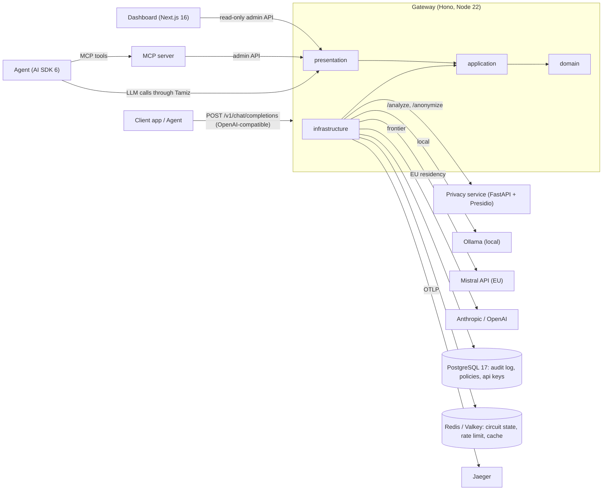
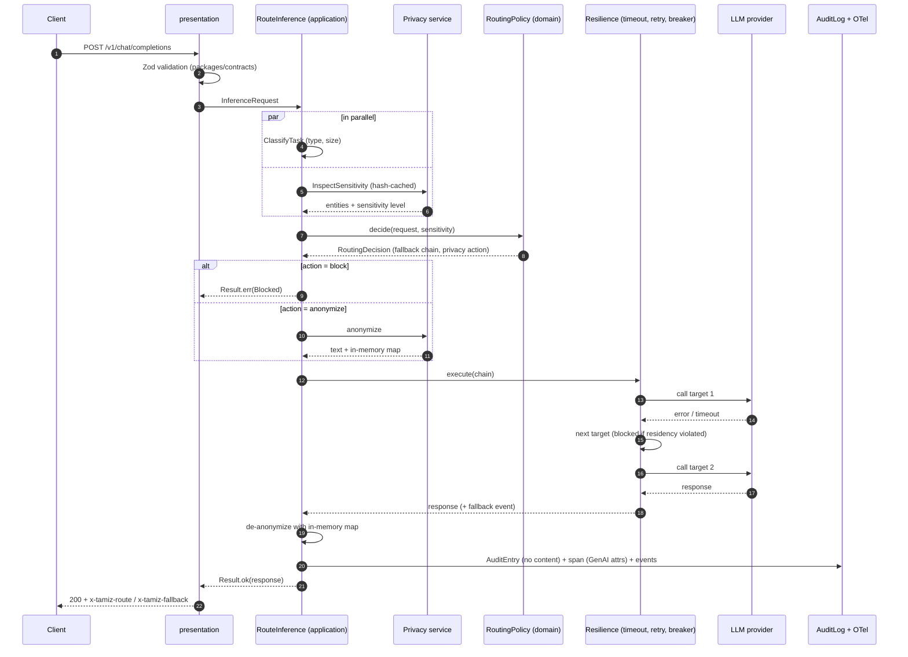
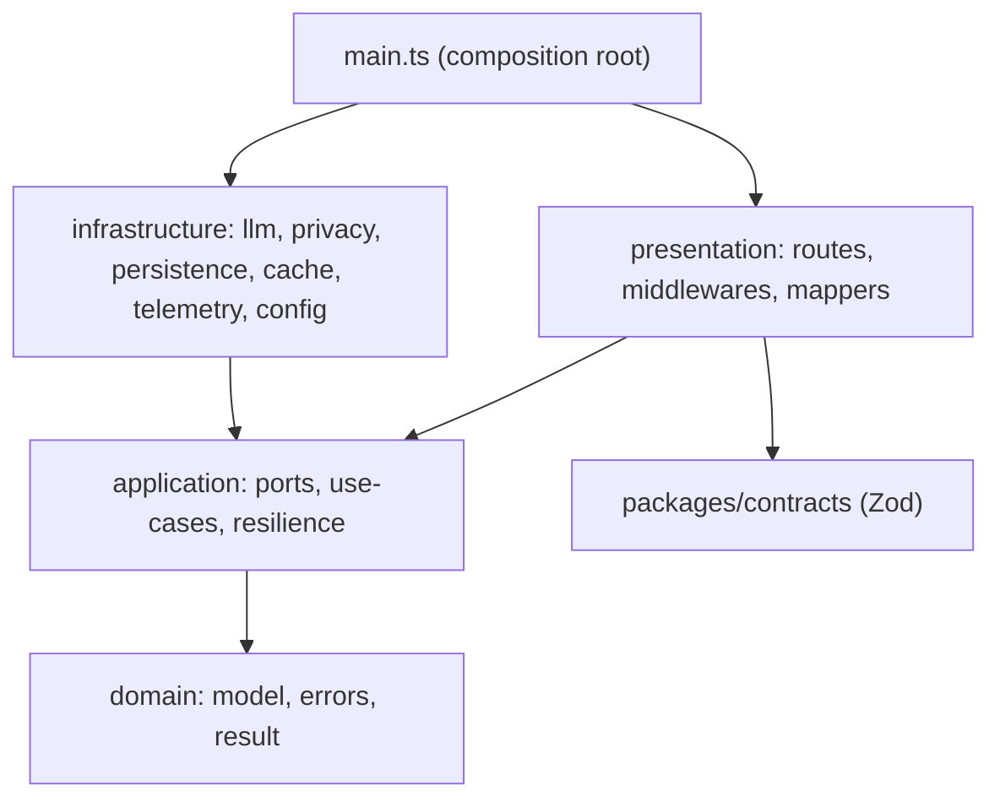

# Tamiz — Architecture

Diagrams for the system view, the request flow and the gateway layers. The narrative and
rationale live in `docs/tamiz-project.md` section 4 and in `docs/adr/`. C4 context and
container diagrams are completed in task `T-DOC-02`.

## System view



## Request flow



## Gateway layers and allowed dependencies



Rules enforced by `.dependency-cruiser.cjs` (feature 001):

| From | May import |
|---|---|
| `domain` | nothing |
| `application` | `domain` |
| `infrastructure` | `application`, `domain` |
| `presentation` | `application`, `domain`, `packages/contracts` |
| `main.ts` | everything (only place that imports `infrastructure`) |

## Privacy service layers

`services/privacy/src/privacy/{domain,application,infrastructure,api}/` mirrors the
gateway: recognizers and sensitivity rules in `domain`, analyze/anonymize use cases in
`application`, Presidio and spaCy engines in `infrastructure`, FastAPI routers in `api`.

## Dashboard

Organised by feature, routes stay thin:

```
apps/dashboard/src/
├── app/                 routes only
├── features/            live-traffic, audit-log, policy-editor, cost-analytics, eval-results
├── components/ui/       shadcn
└── lib/api-client.ts    typed Hono RPC client (hc)
```
